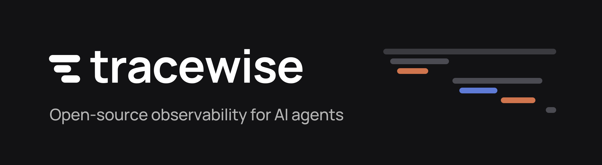
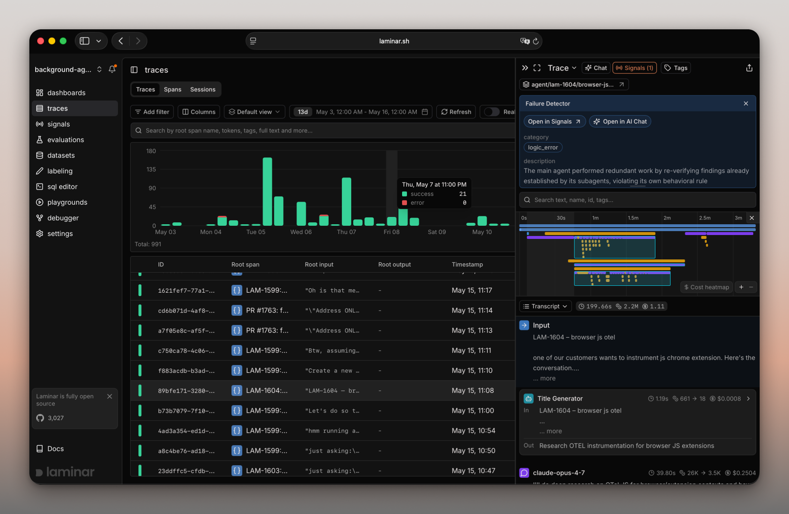

# Tracewise



Tracewise is an open-source observability platform for AI agents. It is built on
[Laminar](https://github.com/lmnr-ai/lmnr) (Apache-2.0); see [NOTICE](./NOTICE).

- **Tracing**: OpenTelemetry-native. Automatically traces Vercel AI SDK, Browser Use, Stagehand, LangChain, OpenAI, Anthropic, Gemini, and more.
- **Signals**: describe agent behavior to watch for in plain English (e.g. "agent is stuck in a loop") and get notified when it happens.
- **Evals**: SDK and CLI for running evals locally or in CI, plus a UI for comparing results.
- **SQL access**: query traces, spans, metrics, and events with SQL, from the UI, the CLI, or MCP.
- **Dashboards**: build dashboards over traces, metrics, and events, including custom SQL.
- **Datasets and annotation**: custom data rendering for fast labeling and dataset creation.
- **Performance**: Rust backend, compressed trace storage, realtime trace viewing, and full-text search over spans.



## Quickstart (Docker Compose)

```sh
git clone https://github.com/BharanitharanKR/Tracewise.git
cd Tracewise
docker compose up -d
```

This starts Postgres, ClickHouse, Quickwit, the app-server, and the frontend. The frontend
image is built from this repository on first run, so the first start takes a few minutes.
Open <http://localhost:5667>.

For a production-like stack with RabbitMQ and Valkey, use
`docker compose -f docker-compose-full.yml up -d`. See [CONTRIBUTING.md](./CONTRIBUTING.md)
for what each compose file runs.

## Local development

For UI work, run the backing services in Docker and the frontend with hot reload:

```sh
cp frontend/.env.local.example frontend/.env.local
docker compose -f docker-compose-local-dev.yml up -d
cd frontend
pnpm install
pnpm run dev
```

The app runs at <http://localhost:3000>. For backend changes, see
[CONTRIBUTING.md](./CONTRIBUTING.md#advanced-running-the-full-stack-locally).

## Sending traces

Tracewise is wire-compatible with the Laminar SDKs, so you instrument your code with them and
point them at your Tracewise instance. Create a project in the UI, generate a project API key,
and set it as `LMNR_PROJECT_API_KEY`.

### TypeScript

```sh
npm add @lmnr-ai/lmnr
```

```typescript
import { Laminar, observe } from '@lmnr-ai/lmnr';

Laminar.initialize({
  projectApiKey: process.env.LMNR_PROJECT_API_KEY,
  baseUrl: 'http://localhost',
  httpPort: 8000,
  grpcPort: 8001,
});

const poemWriter = observe({ name: 'poemWriter' }, async (topic: string) => {
  // LLM calls made here are traced automatically
});
```

### Python

```sh
pip install --upgrade 'lmnr[all]'
```

```python
from lmnr import Laminar, observe

Laminar.initialize(
    project_api_key="<LMNR_PROJECT_API_KEY>",
    base_url="http://localhost",
    http_port=8000,
    grpc_port=8001,
)

@observe()
def poem_writer(topic):
    ...  # LLM calls made here are traced automatically
```

The [Laminar SDK documentation](https://laminar.sh/docs/tracing/introduction) covers
integrations, manual spans, and evals in depth.

## Configuration

All settings for the Docker Compose stacks live in the repository-root `.env`.

### LLM provider (optional)

AI features (chat-with-trace, SQL-with-AI, Signals) need an LLM provider. Pick one;
`LLM_MODEL_SMALL|MEDIUM|LARGE` are optional and fall back to per-provider defaults.
`LLM_DEFAULT_HEADERS_JSON` adds static headers for any provider or gateway.

```sh
# Option A: Gemini
LLM_PROVIDER=gemini
LLM_API_KEY=your_gemini_key

# Option B: OpenAI (or any OpenAI-compatible gateway such as LiteLLM, OpenRouter, vLLM)
LLM_PROVIDER=openai
# LLM_BASE_URL=http://localhost:4000
LLM_API_KEY=your_openai_key

# Option C: AWS Bedrock (Anthropic Claude). Uses AWS credentials instead of LLM_API_KEY.
LLM_PROVIDER=bedrock
AWS_ACCESS_KEY_ID=...
AWS_SECRET_ACCESS_KEY=...
AWS_REGION=us-east-1

# Option D: Azure AI Foundry. Model ids are deployment names, so set LLM_MODEL_*
# unless your deployments are named after the models.
#   azure_chat_completions | azure_responses | azure_anthropic
LLM_PROVIDER=azure_chat_completions
LLM_API_KEY=your_azure_key
AZURE_RESOURCE_ID=your_resource_name   # or AZURE_BASE_URL for private endpoints
```

### Custom Postgres schema (optional)

Tracewise uses the `public` schema by default. To use another one (for example in a shared
Postgres instance), set the same value for the frontend and the app-server:

```sh
POSTGRES_SCHEMA=tracewise
# Set to false if the schema is pre-provisioned or the DB role lacks CREATE.
# POSTGRES_CREATE_SCHEMA=true
```

### Upgrading ClickHouse configuration

The bundled ClickHouse config disables system logs that are not useful on a single node and
keeps query and error logs for three days. After changing it, recreate the container:

```sh
docker compose up -d --force-recreate clickhouse
```

## Usage telemetry

The upstream project sends an anonymous usage heartbeat from self-hosted installs to
Laminar's analytics. Tracewise turns this off by default. It is only sent when
`LAMINAR_TELEMETRY_DISABLED=false` is set explicitly.

## License

Apache License 2.0. See [LICENSE.md](./LICENSE.md) and [NOTICE](./NOTICE).
